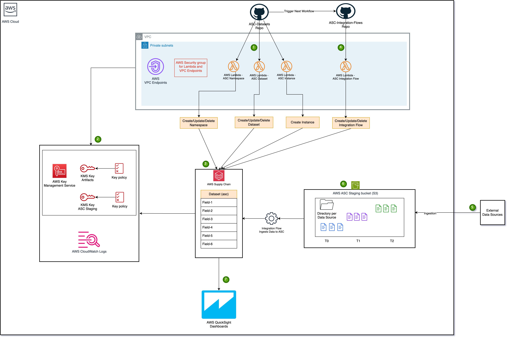

# Software (software, scripts or sample code) is licensed under the Apache License  Version 2.0.
# Author: AWS Professional Services

AWS Supply Chain, as stated by the [AWS documentation](https://docs.aws.amazon.com/aws-supply-chain/latest/userguide/what-is-service.html), is a cloud-based supply chain management application that works with your existing enterprise resource planning (ERP) and supply chain management systems. Using AWS Supply Chain, you can connect and extract your inventory, supply, and demand related data from existing ERP or supply chain systems into one unified AWS Supply Chain data model.

It provides a seamless way for users to store data without having them to worry about managing its infrastructure.

In this solution, we will be focussing on automating the creation of AWS Supply Chain Instance, AWS Supply Chain Datasets and AWS Supply Chain Integration flows.

Please follow the guidelines given below to deploy the solution and then proceed to the part of using AWS Supply Chain Analytics for analyzing the data, powered through Amazon QuickSight.

## Pre-Requisites

- Create a VPC with 2 private subnets in your AWS Account in the region of your choice.
- Fill these values in the following files based on your deployment branch/environment -
    1. [Dev environment inputs for ASC Datasets repository](./ASC-Datasets/terraform-deployment/tfInputs/dev.tfvars)
    2. [Prod environment inputs for ASC Datasets repository](./ASC-Datasets/terraform-deployment/tfInputs/prod.tfvars)
    3. [Dev environment inputs for ASC integration flows repository](./ASC-Integration-Flows/terraform-deployment/tfInputs/dev.tfvars)
    4. [Prod environment inputs for ASC integration flows repository](./ASC-Integration-Flows/terraform-deployment/tfInputs/prod.tfvars)

- Setup secrets in your GitHub organization

    | **Secret**                                | **Value / Description**                                            |
    |-------------------------------------------|--------------------------------------------------------------------|
    | **ACCOUNT_ID_DEV**                        | AWS Deployment Account ID for Dev environment                      |
    | **ACCOUNT_ID_PROD**                       | AWS Deployment Account ID for Prod environment                     |
    | **AWS_ROLE_DEV**                          | Deployment role for Dev environment                                |
    | **AWS_ROLE_PROD**                         | Deployment role for Prod environment                               |
    | **AWS_USER_ROLE_DEV**                     | User's role for Dev environment if accessing through the console   |
    | **AWS_USER_ROLE_PROD**                    | User's role for Prod environment if accessing through the console  |
    | **ARTIFACTORY_HOST**                      | JFrog Artifactory Domain name                                      | 
    | **ARTIFACTORY_USERNAME**                  | JFrog Artifactory Login Username                                   |
    | **ARTIFACTORY_ACCESS_TOKEN**              | JFrog Artifactory Login Access Token                               |

## This repository contains two folders -

1. ### [ASC-Datasets](./ASC-Datasets/)

    - This is a standalone repository and should be deployed in the start.
    - Instructions to deploy this is given in its [README](./ASC-Datasets/README.md)

2. ### [ASC-Integration-Flows](./ASC-Integration-Flows/)

    - This is a standalone repository and should be deployed after Step 1. 
    - Instructions to deploy this is given in its [README](./ASC-Integration-Flows/README.md)

## Architecture

### Steps involved -
1. The ASC Datasets repository is triggered through its workflow or deployed manually.
2. AWS VPC endpoints, AWS Security Groups, AWS KMS keys, and AWS CloudWatch log groups are created.
3. The following AWS Supply Chain resources are created -
    - ASC Instance AWS Lambda that creates the ASC instance.
    - ASC Namespace AWS Lambda that creates/updates/deletes the ASC namesapces.
    - ASC Dataset AWS Lambda that creates/updates/deletes the ASC datasets.
    - AWS Supply Chain Staging S3 bucket is created.
4. The ASC Integration Flows repository is triggered through its workflow or deployed manually that creates the following -
    - ASC Integration Flows AWS Lambda that creates/updates/deletes the integration flows.
5. External systems prepare and send the data to be ingested to the AWS Supply Chain Staging S3 bucket.
6. The AWS Supply Chain staging bucket triggers the integration flow to the AWS ASC Datasets once any data lands on it.
7. The AWS ASC service integrates with AWS QuickSight Analytics to produce dashboards based on the ingested data.

## Setting up AWS Supply Chain access

1. Search for the AWS Supply Chain service in the AWS Console.
2. Head over to the Instance that we created from the dashboard. 
    - This solution uses the name of **asc-deployment-poc-dev-asc-instance**
3. We use IAM Identity Center to manager user access to the AWS Supply Chain instance.
4. Login as the Admin of the application to ensure complete access in utilising this solution.

## Analyzing data with AWS Supply Chain Analytics

1. Setup AWS Supply Chain analytics with this [AWS guide](https://docs.aws.amazon.com/aws-supply-chain/latest/userguide/setting_analytics.html)

2. In this solution, we have demonstrated the creation of **Calendar** and **Outbound_Order_Line** datasets. We will create an Analysis that uses these datasets.

3. AWS Supply Chain provides a prebuilt dashboard for analying the mentioned datasets. We will use the **Seasonability Analysis** Dashboard. Follow the steps mentioned in this [AWS guide](https://docs.aws.amazon.com/aws-supply-chain/latest/userguide/prebuilt_dashboards.html) to add the dashboard.

4. Click on the dashboard to see its analysis that would look like this - 

- The Dashboard provides insights on Demand over the years based on the datasets and the ingested data over it.
- We can further specify the ProductID, CustomerID, years, etc. to view the analysis over those values.

5. This solution can be replicated for more datasets as per the requirements and be queried for further analysis, through AWS Supply Chain provided prebuilt-dashboards or cutom integration with Amazon QuickSight. 